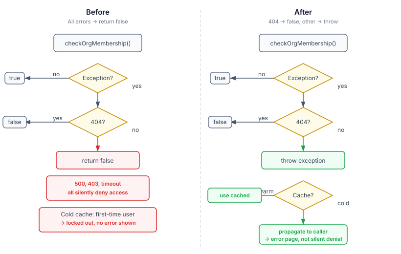

# The 500 That Looked Like a 404

A systematic review of 28 recent commits turned up fifteen findings. Most were cosmetic — stale comments, misleading constants, type safety gaps. One was genuinely dangerous.

The GitHub security augmentor checks org membership on every authenticated request. The GitHub API returns 204 for members, 404 for non-members. The original code caught `WebApplicationException` and did the obvious thing:

```java
private boolean checkOrgMembership(String username) {
    try {
        orgApi.checkMembership(githubOrg, username);
        return true;
    } catch (WebApplicationException e) {
        if (e.getResponse().getStatus() == 404) return false;
        LOG.warnf("GitHub org membership check failed for %s: HTTP %d %s",
                username, e.getResponse().getStatus(), e.getMessage());
        return false;  // ← here
    }
}
```

The catch block handles 404 correctly. Then it handles every other status code — 403, 500, 502, network timeout — identically: log a warning, return false. "Not a member."

A GitHub rate limit at 3am silently revokes every user's access until the limit resets. A GitHub outage during business hours locks out the entire engineering team. The log message is there, but no alert fires because a warning during an API call isn't unusual. The users see a 403 from the application and assume their token expired.

## The cache makes it worse

The augmentor had a transient-failure guard: if a user was previously cached as a member and the API now says "not a member," keep the cached result. Smart — it prevents a GitHub blip from revoking access for known users. But this guard only fires when there's a cached entry.

First request from a new user during a GitHub outage? No cache entry. The 500 becomes "not a member." The guard never triggers. The user is locked out on first contact with no indication that anything went wrong.



## The fix is about failure semantics

The distinction is between "the API told us something" and "the API couldn't tell us anything."

A 404 is information: this user is not a member. Act on it.

A 500 is absence of information: we don't know the user's membership status. Acting on absence — treating "I don't know" as "no" — is the error. The fix makes the distinction explicit:

```java
private boolean checkOrgMembership(String username) {
    try {
        orgApi.checkMembership(githubOrg, username);
        return true;
    } catch (WebApplicationException e) {
        if (e.getResponse().getStatus() == 404) return false;
        throw e;
    }
}
```

Two lines removed, one added. The caller now catches the exception and makes a context-dependent decision: use cached membership if one exists (graceful degradation), or let the exception propagate if this is a cold cache (fail loud, show error page, let the user retry). Silent denial is gone from both paths.

## This pattern is everywhere

The same `catch → return false` structure appeared in the team membership check too. And `GitHubGroupMembershipProvider` has a cousin: non-404 errors silently return an empty member set, which means a GitHub outage makes every RBAC check think every team is empty. Both fixed.

Every codebase has a version of this bug. Any code that calls an external API, catches exceptions broadly, and returns a "safe default" on failure is a candidate. The safe default for "user is authenticated" is not the same as the safe default for "config value has a fallback." Authentication defaults are security decisions. A default of `false` on an auth check is a denial-of-service waiting for the upstream to hiccup.

The broader principle: **error responses and absence-of-response require different handling.** An API that says "no" is giving you information. An API that returns 500 is giving you nothing. Code that conflates the two will silently misbehave under exactly the conditions — outages, rate limits, network partitions — where correct behaviour matters most.

## The other twelve

The audit turned up three other categories beyond auth:

**Semantic drift in constants.** Five evolution workers returned `"status": "MERGED"` for adjustments that were computed but not yet persisted. The status was a presentational constant copied from an early prototype, never updated as the workers' actual semantics diverged from "merged." Renaming to `STATUS_APPLIED` with a shared constant took five minutes and eliminated a class of confusion for anyone reading the output.

**Reinvented standard library.** A custom `minutesToDuration()` method produced ISO-8601 duration strings by manual arithmetic — hours, minutes, edge cases. `java.time.Duration.ofMinutes(n).toString()` does the same thing, handles every edge case the JDK team already thought of, and the person reading the code six months from now won't wonder whether the custom version handles leap seconds. It doesn't need to, but they'll wonder.

**Untyped API responses.** `List<Map<String, Object>>` as the return type of a REST client method. Every consumer casts `.get("login")` to String and hopes GitHub doesn't change the field name. A three-line record — `GitHubTeamMember(String login, Long id)` — makes the contract explicit and moves the failure from a `ClassCastException` at runtime to a deserialization error at the boundary where it belongs.

None of these individually would have caused an incident. Together they form the substrate that incidents grow in — the gap between what the code says and what the code means, widening a little with each commit until something falls through.
